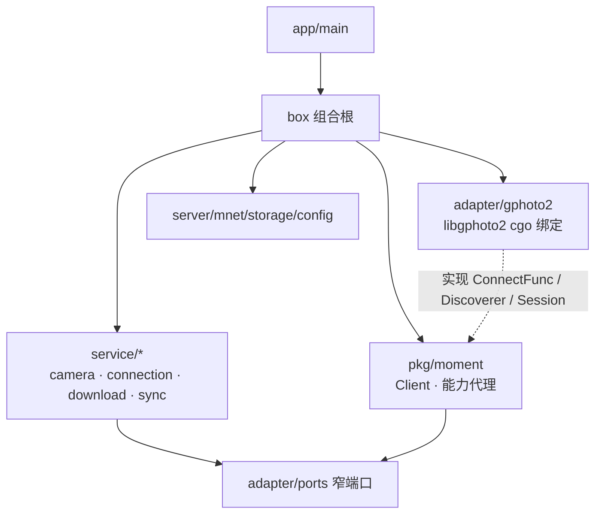
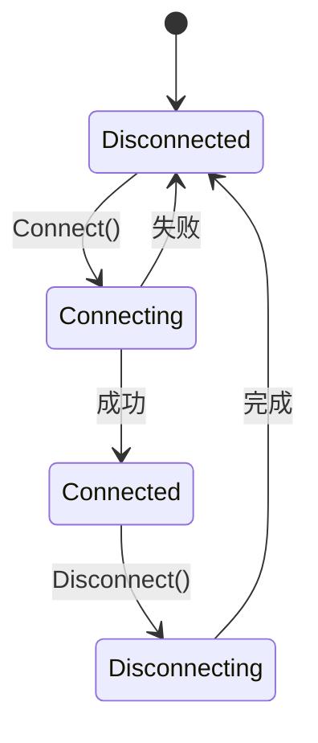

# moment-go

**libgphoto2 的 Go 绑定模块**：把 libgphoto2 的 C API 映射为简洁的 Go API，并围绕**相机会话生命周期**提供四大能力：

1. **连接相机** —— 支持 USB 自动探测 / 指定 USB 端口 / **PTP/IP 网络连接**
2. **预览所有相机内容** —— 递归遍历相机存储目录树
3. **下载内容** —— 下载相机文件到内存或写入任意 `io.Writer`
4. **解析相机信息** —— 摘要、驱动说明、存储信息、配置树

适配层不做平台 / 架构特化：头文件统一取自仓库内的 `libgphoto2-android/include`
（与预编译库同版本，本身即跨平台），链接与运行期使用**当前系统安装的 libgphoto2**；
只有编译 Android 时才改用 `libgphoto2-android/lib` 中随 APK 打包的 `.so`。

> `CGO_ENABLED=0` 构建时使用桩后端（`ErrBackendUnavailable`），
> 保证**可编译、可单测、可演示 API 与生命周期流程**。

## 架构（组合根 + 最小接口）



依赖方向由组合根统一装配：`box` 创建所有长生命周期实例并通过最小接口注入，
服务与适配器不再使用 `Default()` 之类的包级单例。

相机侧按“控制面 / 数据面”分层：`adapter/gphoto2` 的 cgo 绑定接收标准化的
标准化的连接目标（端口路径 + 模型名），并实现 `adapter.Session`：

- `ConnectFunc`：用标准化目标建立连接
- `Discoverer`：自动发现相机
- `Session`：一次连接绑定的内部句柄，组合文件、信息、拍摄事件与生命周期

`Session` 只在 `moment.Client` 与后端之间流转，不直接注入服务。
服务依赖的是 `adapter/ports` 中的窄端口：`FileBrowser` / `FileReader` /
`CameraInfo` / `CaptureSource` / `ConnectionManager` / `TargetResolver` /
`Downloader` / `ConfigStore`。`pkg/moment` 提供绑定 `Client` 的能力代理，
每个服务只声明自己实际使用的能力。

“自动 / USB / PTP/IP 如何转成 `Target`”由 `adapter/ports.TargetResolver` 抽象，
输入直接使用 protobuf 的 `connectionv1.ConnectOption`（oneof 载荷），
默认实现基于 `Discoverer` 探测结果构建参数，不再混入 gphoto2 封装。
`moment.Client` 负责连接生命周期与租约：数据操作通过内部 `withSession` 借用
当前会话；断开时立即取消在途操作、等待租约释放后关闭底层会话。
原本的 `domain.Gateway`、`usecase` 与 `pool/client` 单例层已移除。

**目录结构**

```
moment-go/
├── go.mod
├── app/main.go                    # 入口：创建 box 并运行 gRPC 服务
├── box/                           # 组合根：集中构造依赖图
├── adapter/                       # 后端契约 + 端口 + 实现
│   ├── backend.go                 # ConnectFunc / Discoverer / 内部 Session
│   ├── ports/                     # 服务依赖的窄端口（按能力拆分）
│   ├── target.go                  # TargetResolver（ConnectOption → 连接目标）
│   └── gphoto2/                   # libgphoto2 后端（cgo + 无 cgo 桩）
│       ├── bindings.go            # #cgo 指令（头文件 / 链接）
│       ├── context.go             # GPContext 生命周期
│       ├── client.go              # Client（ConnectFunc / Discoverer）+ Camera Session
│       ├── bootstrap.go           # CAMLIBS / IOLIBS 环境变量
│       └── result.go              # 返回码 → 公共错误
├── pkg/moment/                    # Client 生命周期与能力代理
│   ├── client.go                  # 状态机 / 租约 / withSession
│   ├── capability.go              # 文件、信息、拍摄事件代理
│   └── types.go                   # 公共类型与错误
├── service/                       # gRPC 服务（构造期注入依赖）
│   ├── camera/
│   ├── connection/
│   ├── download/
│   └── sync/
├── server/                        # gRPC Server + 监听网络（无全局单例）
├── storage/                       # 通用文件存储
└── config/                        # 运行期配置存储（无全局单例）
```

## 生命周期



`Client.State()` / `IsConnected()` 可随时查询状态；连接期间的业务操作（浏览 / 下载 / 解析）
在 `Connected` 状态下进行，未连接时返回 `ErrNotConnected`。

## 快速开始

应用侧通过组合根创建全部依赖：

```go
ctx := context.Background()

app, err := box.New(ctx, box.Options{
    // Android 可指定随 APK 解压出来的驱动目录：
    // LibraryRoot: filesDir,
    DataDir: "moment/data",
})
if err != nil {
    panic(err)
}
defer app.Close()

if err := app.Run(ctx); err != nil {
    panic(err)
}
```

作为库使用时，自行注入后端即可；`pkg/moment` 不依赖具体适配器：

```go
backend, err := gphoto2.New(gphoto2.WithLibraryRoot(root))
if err != nil {
    panic(err)
}

client := moment.NewClient(backend.Connect, backend, backend.Close)
resolver := adapter.NewTargetResolver(client)

target, err := resolver.Resolve(ctx, &connectionv1.ConnectOption{
    Mode: connectionv1.ConnectionMode_CONNECTION_MODE_PTPIP,
    Payload: &connectionv1.ConnectOption_Ptp{
        Ptp: &connectionv1.ConnectCameraPTP{PortPath: "192.168.1.100"},
    },
})
if err != nil {
    panic(err)
}

cam, err := client.Connect(ctx, target)
if err != nil {
    panic(err)
}
defer cam.Close(ctx)

content, err := cam.ListTree(ctx)
if err != nil {
    panic(err)
}
fmt.Printf("folders=%d files=%d\n", len(content.Folders), len(content.Files))
```

### USB 连接

```go
// 自动探测（取第一个相机）
target, err := resolver.Resolve(ctx, &connectionv1.ConnectOption{
	Mode: connectionv1.ConnectionMode_CONNECTION_MODE_AUTO,
})
cam, err := client.Connect(ctx, target)

// 按 USB VID/PID 选择相机（均为 0 时取第一个探测结果）
target, err = resolver.Resolve(ctx, &connectionv1.ConnectOption{
	Mode: connectionv1.ConnectionMode_CONNECTION_MODE_USB,
	Payload: &connectionv1.ConnectOption_Usb{
		Usb: &connectionv1.ConnectCameraUSB{
			UsbVendorId:  0x04a9,
			UsbProductId: 0x32ab,
		},
	},
})
cam, err = client.Connect(ctx, target)
```

### 错误分类

公共错误哨兵：`moment.ErrNotConnected`、`moment.ErrModelNotFound`、`moment.ErrFileNotFound`、
`moment.ErrDirectoryNotFound`、`moment.ErrCameraBusy`、`moment.ErrCancelled`、
`moment.ErrBackendUnavailable`（旧的 `ErrUnsupportedPlatform` 保留为等价别名）等，
可用 `errors.Is` 判断。

## 构建

头文件始终取自 `libgphoto2-android/include`；链接与运行期按平台选择：
宿主（Linux / macOS）用系统安装的 libgphoto2，Android 用随 APK 打包的 `.so`。

### 宿主（Linux / macOS）

```sh
go build ./...   # CGO_ENABLED=1（默认），链接系统 libgphoto2
go vet ./...
go test ./...
```

需要系统提供可链接的 libgphoto2 与 libltdl（含运行期 camlib / iolib）：

| 平台 | 安装 |
|---|---|
| Debian / Ubuntu | `apt-get install libgphoto2-dev libltdl-dev` |
| macOS (Homebrew) | `brew install libgphoto2 libtool` |

非标准安装前缀用 `CGO_CFLAGS` / `CGO_LDFLAGS` 补充，例如
`CGO_LDFLAGS="-L/opt/local/lib" go build ./...`（MacPorts）。
没有 C 工具链或不想链接系统库时，退回桩后端：

```sh
CGO_ENABLED=0 go build ./...
```

### Android（arm64）

`libgphoto2-android/lib` 提供 Android **arm64-v8a** 动态库，构建需要 NDK。
Android 目标下 cgo 会自动把 `-L` 指向 `libgphoto2-android/lib`：

```sh
export NDK=$HOME/Library/Android/sdk/ndk/<版本>
export CC=$NDK/toolchains/llvm/prebuilt/darwin-x86_64/bin/aarch64-linux-android21-clang

GOOS=android GOARCH=arm64 CGO_ENABLED=1 CC=$CC \
  go build -o app_demo ./app
```

链接依赖：`libgphoto2.so`、`libgphoto2_port.so`、`libltdl.so`、`libm.so`
（NDK 提供 `libm/libc/libdl`）；`-I` 始终通过 `${SRCDIR}` 相对路径指向仓库内头文件。

## Dev Container（推荐）

仓库自带开发容器（`.devcontainer/`），内置 **Go 1.26.1 + Android NDK r27d**，
并配置好全部 NDK 环境变量，开箱即可交叉编译：

```sh
# 进入容器后（VS Code: “Reopen in Container”；Zed 同样支持 .devcontainer）

# ① 宿主（linux/amd64）构建 + 单测（链接系统 libgphoto2，容器内已装 libgphoto2-dev）
go build ./... && go test ./...

# ② Android (arm64) 交叉编译（自动使用 NDK clang 链接 libgphoto2）
bash .devcontainer/build-android.sh          # 产物：bin/app-android-arm64
```

容器内已配置的环境变量：

| 变量 | 值 | 用途 |
|---|---|---|
| `ANDROID_NDK_HOME` / `ANDROID_NDK_ROOT` | `/opt/android-ndk` | NDK 根目录 |
| `ANDROID_HOME` | `/opt/android-sdk` | Android SDK 根（NDK 存放于此约定路径） |
| `ANDROID_API_LEVEL` | `27` | bionic API 级别（与 libgphoto2 构建环境一致） |
| `PATH` | 含 `.../prebuilt/linux-x86_64/bin` | NDK 工具链可直接调用 |

进入容器后 `postCreateCommand` 会自动验证：Go 版本、NDK clang、宿主构建、
Android 交叉编译（生成 `bin/app-android-arm64`），全部通过才视为环境就绪。

**自定义版本**：修改 `.devcontainer/devcontainer.json` 的 `build.args`
（`GO_VERSION` / `NDK_VERSION` / `ANDROID_API_LEVEL`），并同步 `remoteEnv` 中
对应值；或直接改 `.devcontainer/Dockerfile` 的 `ARG` 默认值。

**编辑器（gopls）**：容器内 gopls 以 `CGO_ENABLED=0` 运行（见 `customizations`），
此时分析的是桩后端，避免编辑器依赖 C 工具链；真机构建仍由命令行 `CC` 驱动。

## 运行时部署（Android）

libgphoto2 通过环境变量定位驱动（插件）目录。宿主平台无需设置——libgphoto2 会使用
自身编译期默认路径搜索系统安装的驱动；Android 上由 `box.Options.LibraryRoot` / `gphoto2.WithLibraryRoot` 设置：

```
CAMLIBS  = <root>/libgphoto2/<版本>/        # ptp2.so 等相机驱动
IOLIBS   = <root>/libgphoto2_port/<版本>/   # ptpip.so、usb1.so 等端口驱动
```

版本目录由 `Bootstrap` 自动探测（如 `2.5.34.1` / `0.12.2`），无需硬编码。

将 `libgphoto2-android/jniLibs/arm64-v8a/` 中的 `.so` 打包进 APK 的 `jniLibs`
（确保 `libgphoto2.so`、`libgphoto2_port.so`、`libltdl.so`、`libusb-1.0.so` 在 APK 内），
应用启动后把 camlib / iolib 的 `.so` 解压到应用 `files` 目录（如 `filesDir/libgphoto2/2.5.34.1/`、
`filesDir/libgphoto2_port/0.12.2/`），再以 `gphoto2.WithLibraryRoot(filesDir)` / `box.Options.LibraryRoot` 配置后端。

> camlib/iolib 的文件名无需与原始一致（加载器按符号发现插件），
> 直接复制 `jniLibs` 中重命名的 `libgphoto2_camlib_ptp2.so` 等亦可。

## PTP/IP 连接原理

- `gp_port_info_list_load` 加载 iolib，`ptpip.so` 注册 "PTP/IP Connection" 端口
  （路径前缀 `^ptpip:`，正则匹配器）。
- 适配层以 `gp_port_info_list_lookup_path("ptpip:<host>[:<port>]")` 匹配该端口，
  并把实际路径写回端口信息，供 ptp2 驱动解析主机地址。
- 相机模型固定取能力表中的 `"PTP/IP Camera"`。

## 验证

本地（无相机）执行：

```sh
go build ./...                  # 链接系统 libgphoto2
go vet ./...                    # 静态检查（含 cgo 绑定）
go test ./...                   # 生命周期 / 目录树遍历 / 下载 / 信息聚合 / 错误映射 / 驱动目录探测
CGO_ENABLED=0 go build ./...    # 桩后端，无 C 工具链也可编译
go run ./app                    # 对外 API 与生命周期演示（未接相机时 Detect 返回空列表）
```

## 限制与后续

- cgo 构建要求系统存在 libgphoto2 / libltdl 的开发包（提供链接名）；无 C 工具链时
  用 `CGO_ENABLED=0` 走桩后端。
- 配置树当前为只读解析；写配置（`SetConfig`）与拍照（`Capture`）可作为后续用例扩展。
- 下载为整体内存传输；超大文件可基于 `gp_camera_file_read` 分块流式化。
