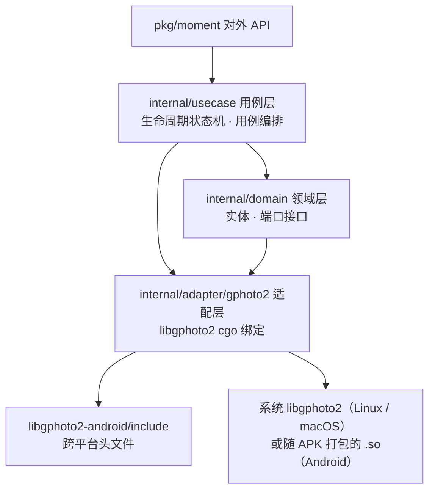
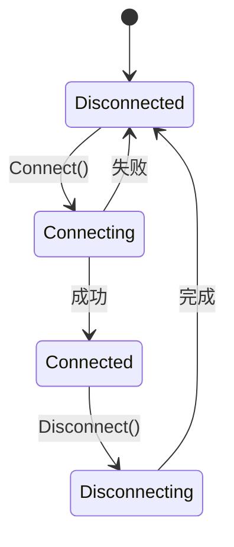

# moment-go

**libgphoto2 的 Go 绑定模块**：把 libgphoto2 的 C API 映射为简洁的 Go API，并围绕**相机会话生命周期**提供四大能力：

1. **连接相机** —— 支持 USB 自动探测 / 指定 USB 端口 / **PTP/IP 网络连接**
2. **预览所有相机内容** —— 递归遍历相机存储目录树
3. **下载内容** —— 下载相机文件到内存或写入任意 `io.Writer`
4. **解析相机信息** —— 摘要、驱动说明、存储信息、配置树

适配层不做平台 / 架构特化：头文件统一取自仓库内的 `libgphoto2-android/include`
（与预编译库同版本，本身即跨平台），链接与运行期使用**当前系统安装的 libgphoto2**；
只有编译 Android 时才改用 `libgphoto2-android/lib` 中随 APK 打包的 `.so`。

> `CGO_ENABLED=0` 构建时使用桩后端（`ErrBackendUnavailable`），
> 保证**可编译、可单测、可演示 API 与生命周期流程**。

## 架构（整洁架构）



依赖方向由外向内，领域层不依赖任何外部实现；适配层实现领域层定义的端口接口。

**目录结构**

```
moment-go/
├── go.mod
├── app/main.go                    # demo（本地桩环境即可运行）
├── pkg/moment/                    # delivery：对外公共 API
│   ├── moment.go                  # Client / Camera
│   ├── types.go                   # 公共类型与错误哨兵
│   └── options.go                 # libgphoto2 库目录选项
└── internal/
    ├── domain/                    # 领域层：实体 + 端口 + 错误
    │   ├── types.go               # Camera / File / ConfigItem / State ...
    │   ├── gateway.go             # Gateway / CameraSession 接口
    │   └── errors.go
    ├── usecase/                   # 用例层：生命周期 + 用例编排
    │   ├── lifecycle.go           # 状态机
    │   └── app.go                 # Connect / ListTree / Download / GetInfo ...
    └── adapter/gphoto2/           # 适配层：cgo 绑定（全平台）+ 桩（CGO_ENABLED=0）
        ├── bindings.go            # #cgo 指令（头文件 / 链接）
        ├── context.go             # GPContext 生命周期
        ├── gateway.go             # cgo 后端实现（PTP/IP、浏览、下载、解析）
        ├── gateway_stub.go        # 无 cgo 时的默认桩实现
        ├── bootstrap.go           # CAMLIBS / IOLIBS 环境变量
        └── result.go              # 返回码 → 领域错误
```

## 生命周期



`Client.State()` / `IsConnected()` 可随时查询状态；连接期间的业务操作（浏览 / 下载 / 解析）
在 `Connected` 状态下进行，未连接时返回 `ErrNotConnected`。

## 快速开始

```go
package main

import (
	"context"
	"fmt"

	"ci.zevix.uk/moment-go/pkg/moment"
	connectionv1 "ci.zevix.uk/moment-go/protogo/connection/v1"
)

func main() {
	ctx := context.Background()

	// 创建客户端。桌面端默认使用系统安装的 libgphoto2；
	// Android 上先解压 .so，再传入布局根目录：
	// client, err := moment.New(moment.WithLibraryRoot(filesDir))
	client, err := moment.New()
	if err != nil {
		panic(err)
	}

	// 1) 连接：PTP/IP 网络连接（相机 WiFi/IP 模式）
	cam, err := client.Connect(ctx, moment.ConnectOptions{
		Type: connectionv1.ConnectionMode_CONNECTION_MODE_PTPIP,
		Host: "192.168.1.100",
	})
	if err != nil {
		panic(err)
	}
	defer cam.Close(ctx)

	// 2) 预览所有相机内容（递归遍历目录树）
	content, err := cam.ListTree(ctx)
	if err != nil {
		panic(err)
	}
	fmt.Printf("folders=%d files=%d\n", len(content.Folders), len(content.Files))

	// 3) 下载第一个文件
	if len(content.Files) > 0 {
		f := content.Files[0]
		data, err := cam.Download(ctx, f.Folder, f.Name)
		if err != nil {
			panic(err)
		}
		fmt.Printf("downloaded %s (%d bytes)\n", f.Name, len(data))
	}

	// 4) 解析相机信息
	info, err := cam.GetInfo(ctx)
	if err != nil {
		panic(err)
	}
	fmt.Println(info.Summary)

	_ = client.Disconnect(ctx)
}
```

### USB 连接

```go
// 自动探测（取第一个 USB 相机）
cam, err := client.Connect(ctx, moment.ConnectOptions{
	Type: connectionv1.ConnectionMode_CONNECTION_MODE_AUTO,
})

// 指定端口连接
cam, err := client.Connect(ctx, moment.ConnectOptions{
	Type:    connectionv1.ConnectionMode_CONNECTION_MODE_USB,
	USBPort: "usb:001,002",
})
```

### 错误分类

公共错误哨兵：`moment.ErrNotConnected`、`moment.ErrModelNotFound`、`moment.ErrFileNotFound`、
`moment.ErrDirectoryNotFound`、`moment.ErrCameraBusy`、`moment.ErrCancelled`、
`moment.ErrBackendUnavailable`（旧的 `ErrUnsupportedPlatform` 保留为等价别名）等，
可用 `errors.Is` 判断。

## 构建

头文件始终取自 `libgphoto2-android/include`；链接与运行期按平台选择：
宿主（Linux / macOS）用系统安装的 libgphoto2，Android 用随 APK 打包的 `.so`。

### 宿主（Linux / macOS）

```sh
go build ./...   # CGO_ENABLED=1（默认），链接系统 libgphoto2
go vet ./...
go test ./...
```

需要系统提供可链接的 libgphoto2 与 libltdl（含运行期 camlib / iolib）：

| 平台 | 安装 |
|---|---|
| Debian / Ubuntu | `apt-get install libgphoto2-dev libltdl-dev` |
| macOS (Homebrew) | `brew install libgphoto2 libtool` |

非标准安装前缀用 `CGO_CFLAGS` / `CGO_LDFLAGS` 补充，例如
`CGO_LDFLAGS="-L/opt/local/lib" go build ./...`（MacPorts）。
没有 C 工具链或不想链接系统库时，退回桩后端：

```sh
CGO_ENABLED=0 go build ./...
```

### Android（arm64）

`libgphoto2-android/lib` 提供 Android **arm64-v8a** 动态库，构建需要 NDK。
Android 目标下 cgo 会自动把 `-L` 指向 `libgphoto2-android/lib`：

```sh
export NDK=$HOME/Library/Android/sdk/ndk/<版本>
export CC=$NDK/toolchains/llvm/prebuilt/darwin-x86_64/bin/aarch64-linux-android21-clang

GOOS=android GOARCH=arm64 CGO_ENABLED=1 CC=$CC \
  go build -o app_demo ./app
```

链接依赖：`libgphoto2.so`、`libgphoto2_port.so`、`libltdl.so`、`libm.so`
（NDK 提供 `libm/libc/libdl`）；`-I` 始终通过 `${SRCDIR}` 相对路径指向仓库内头文件。

## Dev Container（推荐）

仓库自带开发容器（`.devcontainer/`），内置 **Go 1.26.1 + Android NDK r27d**，
并配置好全部 NDK 环境变量，开箱即可交叉编译：

```sh
# 进入容器后（VS Code: “Reopen in Container”；Zed 同样支持 .devcontainer）

# ① 宿主（linux/amd64）构建 + 单测（链接系统 libgphoto2，容器内已装 libgphoto2-dev）
go build ./... && go test ./...

# ② Android (arm64) 交叉编译（自动使用 NDK clang 链接 libgphoto2）
bash .devcontainer/build-android.sh          # 产物：bin/app-android-arm64
```

容器内已配置的环境变量：

| 变量 | 值 | 用途 |
|---|---|---|
| `ANDROID_NDK_HOME` / `ANDROID_NDK_ROOT` | `/opt/android-ndk` | NDK 根目录 |
| `ANDROID_HOME` | `/opt/android-sdk` | Android SDK 根（NDK 存放于此约定路径） |
| `ANDROID_API_LEVEL` | `27` | bionic API 级别（与 libgphoto2 构建环境一致） |
| `PATH` | 含 `.../prebuilt/linux-x86_64/bin` | NDK 工具链可直接调用 |

进入容器后 `postCreateCommand` 会自动验证：Go 版本、NDK clang、宿主构建、
Android 交叉编译（生成 `bin/app-android-arm64`），全部通过才视为环境就绪。

**自定义版本**：修改 `.devcontainer/devcontainer.json` 的 `build.args`
（`GO_VERSION` / `NDK_VERSION` / `ANDROID_API_LEVEL`），并同步 `remoteEnv` 中
对应值；或直接改 `.devcontainer/Dockerfile` 的 `ARG` 默认值。

**编辑器（gopls）**：容器内 gopls 以 `CGO_ENABLED=0` 运行（见 `customizations`），
此时分析的是桩后端，避免编辑器依赖 C 工具链；真机构建仍由命令行 `CC` 驱动。

## 运行时部署（Android）

libgphoto2 通过环境变量定位驱动（插件）目录。宿主平台无需设置——libgphoto2 会使用
自身编译期默认路径搜索系统安装的驱动；Android 上由 `moment.WithLibraryRoot` 设置：

```
CAMLIBS  = <root>/libgphoto2/<版本>/        # ptp2.so 等相机驱动
IOLIBS   = <root>/libgphoto2_port/<版本>/   # ptpip.so、usb1.so 等端口驱动
```

版本目录由 `Bootstrap` 自动探测（如 `2.5.34.1` / `0.12.2`），无需硬编码。

将 `libgphoto2-android/jniLibs/arm64-v8a/` 中的 `.so` 打包进 APK 的 `jniLibs`
（确保 `libgphoto2.so`、`libgphoto2_port.so`、`libltdl.so`、`libusb-1.0.so` 在 APK 内），
应用启动后把 camlib / iolib 的 `.so` 解压到应用 `files` 目录（如 `filesDir/libgphoto2/2.5.34.1/`、
`filesDir/libgphoto2_port/0.12.2/`），再以 `moment.WithLibraryRoot(filesDir)` 创建客户端。

> camlib/iolib 的文件名无需与原始一致（加载器按符号发现插件），
> 直接复制 `jniLibs` 中重命名的 `libgphoto2_camlib_ptp2.so` 等亦可。

## PTP/IP 连接原理

- `gp_port_info_list_load` 加载 iolib，`ptpip.so` 注册 "PTP/IP Connection" 端口
  （路径前缀 `^ptpip:`，正则匹配器）。
- 适配层以 `gp_port_info_list_lookup_path("ptpip:<host>[:<port>]")` 匹配该端口，
  并把实际路径写回端口信息，供 ptp2 驱动解析主机地址。
- 相机模型取能力表中的 `"PTP/IP Camera"`（可通过 `ConnectOptions.Model` 覆盖，
  例如索尼相机的 `"Sony:ILCE-7M5 (MTP mode)"`）。

## 验证

本地（无相机）执行：

```sh
go build ./...                  # 链接系统 libgphoto2
go vet ./...                    # 静态检查（含 cgo 绑定）
go test ./...                   # 生命周期 / 目录树遍历 / 下载 / 信息聚合 / 错误映射 / 驱动目录探测
CGO_ENABLED=0 go build ./...    # 桩后端，无 C 工具链也可编译
go run ./app                    # 对外 API 与生命周期演示（未接相机时 Detect 返回空列表）
```

## 限制与后续

- cgo 构建要求系统存在 libgphoto2 / libltdl 的开发包（提供链接名）；无 C 工具链时
  用 `CGO_ENABLED=0` 走桩后端。
- 配置树当前为只读解析；写配置（`SetConfig`）与拍照（`Capture`）可作为后续用例扩展。
- 下载为整体内存传输；超大文件可基于 `gp_camera_file_read` 分块流式化。
